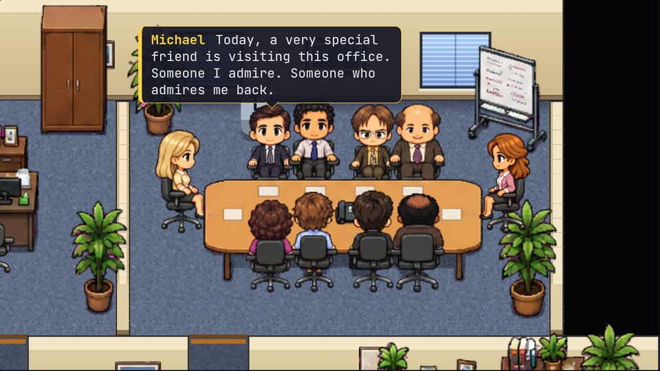
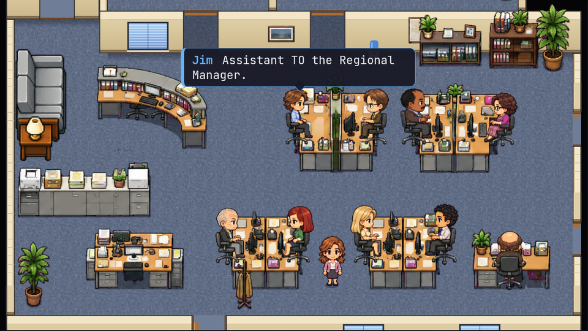
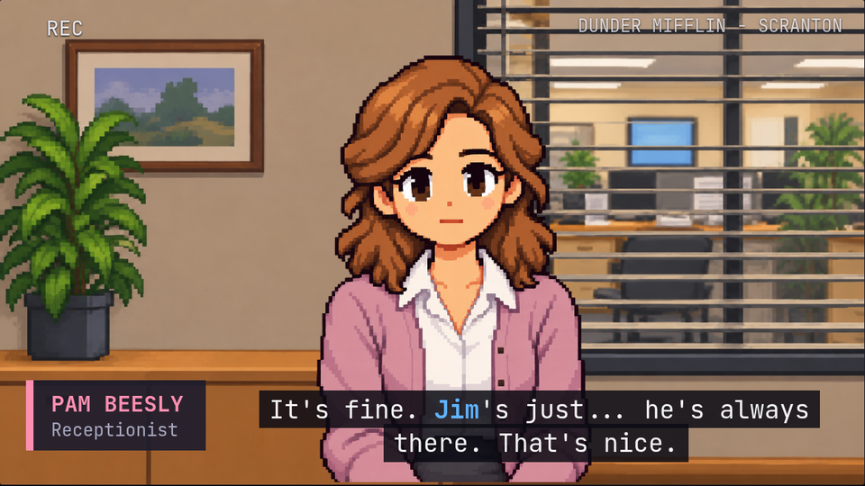

# Infinite The Office

**Never-ending generative *The Office* (US).** A screensaver-style sitcom that writes itself. Claude writes each season's plan and every ~10-minute episode. A deterministic engine stages it on a sprite-drawn floor plan of Dunder Mifflin Scranton: characters walk around, talk in speech balloons, hold conference-room meetings, and cut to a confessional close-up for talking heads.



| | |
|---|---|
|  |  |

**Watch it:** https://staudt.github.io/infinite-the-office/ plays *Scranton: The Golden Years*, a pre-generated 12-episode season written by Claude, and its sequel *Scranton: Growing Up* (Michael and Holly, Pam's year in New York, Angela's secret), with no API key needed. Then make your own: give it a direction ("Andy's era", "Michael's last year", "what if Dwight ran the branch") and Claude writes a new show.

Fan project, not affiliated with NBC/Universal. It uses the characters' names and no official assets; the pixel art is AI-generated. The engine is built on [infinite-wrestling](https://github.com/staudt/infinite-wrestling).

## Run it

```bash
npm install
cp .env.example .env        # add ANTHROPIC_API_KEY so Claude writes the show
npm run server              # writer proxy on :8787 (keeps the key server-side)
npm run dev                 # open the printed URL
```

`npm run server` and `npm run pregen` read `.env`. Variables:

| Variable | Default | Purpose |
|----------|---------|---------|
| `ANTHROPIC_API_KEY` | none | Enables writing. Without it, stored shows and the demo still play. |
| `WRITER_MODEL` | `claude-haiku-5-5` | Writes each episode. |
| `WRITER_PLAN_MODEL` | `claude-sonnet-5-5` | Season bibles and cast changes. |
| `PORT` | `8787` | Writer proxy port. |
| `SESSIONS_DIR`, `LIBRARY_DIR` | `sessions`, `library` | Where saved and curated shows live. |

The first visit opens the **start screen** (press `N` to reopen it):

- **New series**: Claude creates a cast and writes the first season. You can add an optional name and direction (era, cast, tone) or start from a preset. The direction is saved with the series and steers every writing call.
- **Stored shows**: every series you watch live is saved and plays back from Episode 1 for free, even with the server down. When a stored show runs out, new episodes are written live and saved.
- **Continue** the current show.

Episode N+1 is written while N airs; the arrows next to the episode title in the side panel switch episodes once the next one is ready. After the cold open, the show's logo and the episode title play over the office. The footer shows the connection: live (with model names), server up without a key, or not connected.

Keys: `space` pause · `1`–`4` speed (1/2/4/8x) · `←`/`→` previous/next scene · `d` debug panel · `f` fullscreen · `N` shows · `Esc` close the start screen.

URL params (read in `src/main.ts`): `?show=<id>` opens a stored show, `?ep=N` and `?scene=N` jump to an episode and scene (1-based scene), `?play=new|library` and `?id=<id>` select a program, `?direction=` and `?name=` prefill a new series, `?demo` plays the built-in demo episode, and `?seed=N` sets the seed.

### Seasons

A season is 12 episodes. At the start of each season, the plan model writes a **season bible**: a theme, a cast configuration drawn from any era of the show, 3–5 long-term arcs, recurring extras, running gags, and tentpole episodes. Tentpoles come from `data/writer/tentpoles.json` (the Dundies, the Christmas party, Halloween, and so on), and the finale is always the last episode of the season.

## Commands

```bash
npm run pregen -- --direction "…" --name "…" --episodes 12   # or --seasons 1
npm run pregen -- --show <id> --episodes 5                  # extend a stored show
npm run library                                             # list stored shows
npm run library -- add <id>                                 # copy a saved show into library/
npm run import -- --dir <drafts>                            # hand-written bible.json + ep-NN.json drafts -> library/<id>/ (no API)
npm run preview -- --show <id> --ep 3 [--quiet]             # headless transcript -> sessions/<id>/ep-003.md
```

`pregen` prints calls, tokens, and estimated cost when it finishes. Rough costs: an episode is about $0.01–0.02 on Haiku and $0.07–0.12 on Sonnet; a season bible on Sonnet is about $0.04. The published demo season was written entirely by Sonnet (`WRITER_MODEL=claude-sonnet-5-5 WRITER_PLAN_MODEL=claude-sonnet-5-5 npm run pregen -- …`; shell variables override `.env`).

Saved shows live in `sessions/<id>/` (git-ignored). Curated shows live in `library/<id>/` (committed). `library/` is bundled into the GitHub Pages build by `.github/workflows/pages.yml`, which runs on push to `master`. To publish a show, pregen it, run `npm run library -- add <id>`, then commit `library/`.

### Rendering videos

```bash
npm run render -- --show <id> --ep 3                         # one episode -> renders/<id>-s1e03.mp4
npm run render -- --show <id> --ep 3 --scene 2               # one scene (a clip)
npm run render -- --show <id> --season 1                     # every stored episode of a season
npm run render -- --show <id> --ep 12 --format vertical      # 1080x1920 for Shorts/Reels
```

Options: `--demo`, `--fps 24` (default 30), `--out renders`. The renderer steps the deterministic show frame by frame in headless Chromium and pipes frames to ffmpeg. It needs `ffmpeg` on the PATH and Chrome or Chromium; set `CHROMIUM_PATH` if it isn't found.

## Tuning the writing without code

- `data/writer/style.md`: tone, voices, episode shape.
- `data/writer/constraints.md`: what the engine can stage. `{{SETS}}` is filled in from the set files.
- `data/writer/format.md`: beat shapes.
- `data/writer/directives.json`: random weekly nudges (two per episode, seeded).
- `data/writer/tentpoles.json`: special episodes and `seasonLength` (12).
- `src/writer/validate.ts`: repair caps (camera looks, talking heads per scene) are constants at the top of the file.

Model output that needed repairs is saved to `sessions/failures/` for prompt tuning. Only an unplayable result pays for a retry.

## Floor plans and cast

- `data/sets/` holds the logic maps (walking, seats, regions, exits). The office is an art-scale floor plan, `office.layout.json` (walls, doors, windows, furniture, named spots and rooms in pixels), rasterized onto a hidden 16 px walking grid. The other sets (break room, kitchen, annex, parking lot, warehouse, offsite) are still ASCII grids drawn procedurally until they get art. The file name is the set id. See `data/sets/README.md`.
- `npm test` checks that every spot and region the writer relies on exists and that every seat is reachable.
- `data/cast.json` defines each character: color, job title, seasons, desk, voice, and quirks. Characters without art are drawn as a placeholder body in their color with their letter.

## Art

Source art lives in `art/raw/` (AI-generated pixel art on a flat magenta background); `npm run sprites` keys, slices and aligns it into `public/sprites/` using the manifest `art/sprites.json`. Restart `npm run dev` afterwards.

- **Characters:** one sheet per character in the layout of `art/templates/pam-sheet.png`: walk front/back/side (5 frames each), sit front/back/side, typing ×2, phone, and five reactions (gasp, laugh, sad, facepalm, look at camera). Add it as `{ "kind": "character", "name": "<id>", "key": true, "gap": 12, "height": 132 }`; `height` sets how tall they stand (Pam is 128).
- **Talking heads:** `<id>_head` plus optional `_talk` (mouth open), `_happy` and `_happy_talk`, framed like `art/templates/pam-confessional.png`.
- **Furniture:** sliced from sheets into named props and placed in `office.layout.json`.

Anything missing falls back gracefully: placeholder bodies, a placeholder portrait, empty chairs, or emote icons.

## How it works

Three layers. The writer decides **what** happens; the engine decides **how**.

1. **Writer** (`server/writer.ts`, `src/writer/`, `src/schema/`): Claude fills a tool with flat beats split by scene markers, which are converted into a nested episode. Parsing is lenient: broken beats are dropped individually rather than failing the whole episode.
2. **Director** (`src/choreo/director.ts`): turns beats into coroutines over actor primitives (walk, say, act), handling blocking rules and ambient office life.
3. **Engine** (`src/engine/`): a fixed-step 60 Hz scheduler with seeded randomness. The same episode always plays identically, which is what makes jumping to a moment and rendering video possible.

Series state (roster, relationships, gags, notes, arcs, story so far) lives in `src/world/` and is rebuilt purely by replaying stored episodes. Views (`src/view/`) subscribe to engine events. The sprite map (canvas) and the drawn confessional are the only views, and a new renderer can replace them without touching the engine or the episodes.

## Tests

```bash
npm test          # Vitest suite, including the floor plan checks
npm run typecheck
```
